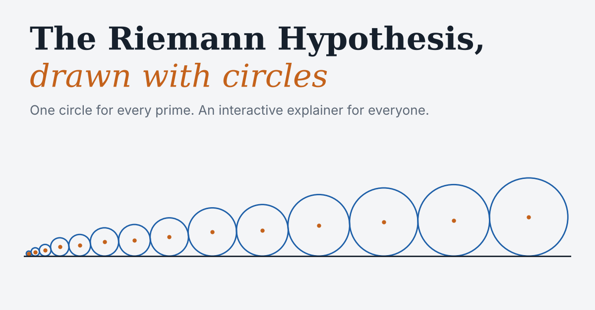

# The Riemann Hypothesis, Drawn with Circles

**An interactive explainer of the most famous problem in mathematics, for everyone. No formulas needed until the very end.**

👉 **Open it here: https://ninjas1337.github.io/Riemann-Hypothesis-Drawn-with-Circles/**



## The idea in one paragraph

Draw a circle of radius 2 standing on a line. Next to it, a circle of radius 3, just touching. Then 5, 7, 11, and so on: one circle for every prime. The centres follow a smooth curve predicted by the prime number theorem, but never exactly; they wobble. Split that wobble into its frequencies and out come 14.13, 21.02, 25.01, 30.42 … the zeros of the Riemann zeta function. Replace the primes with random numbers and the zeros vanish. The Riemann Hypothesis says the wobble never grows beyond a certain size, no matter how far you go.

## What the page covers

1. **The circles:** one circle of prime radius for every prime, each touching the next.
2. **Complex numbers are not complex:** *i* is just a quarter-turn; the "imaginary" axis is the direction at right angles to the number line. For a 3D version with a sphere, see [Complex numbers are not imaginary](https://ninjas1337.github.io/Imaginary-numbers-are-real/).
3. **The wobble:** how far each centre lies from the smooth curve, for every prime up to 100 million.
4. **The wobble is music:** its hidden frequencies are the zeta zeros; with random numbers they disappear. The wobble rebuilt from "wheels", one per zero.
5. **What the hypothesis says:** all wheels stay the same size. Move one zero off the critical line and the wobble runs away.
6. **Where it stands:** the reported proof of November 2026, and what a proof would settle.

## The Prime Gearbox

👉 **https://ninjas1337.github.io/Riemann-Hypothesis-Drawn-with-Circles/machine.html**

A virtual mechanical machine: Lehmer-style sieve gears feed a ratchet that moves a prime shaft by 2√(pq) per prime; a cam cut to 2·li(y²) − y − 3 drives a smooth shaft; a controller of zeta-zero oscillators (wheels turning at γ in log-time, size 4/|ρ+1|) feeds a differential that shows the remaining slip. A chart recorder traces the slip, and a pole diagram lets you drag the first zero off the critical line: the slip then grows an oscillation the real primes do not have. In control language, the prime-power impulses in log-time have the transfer function −ζ′(s)/ζ(s), whose poles are the zeta zeros; RH says they all sit on the stability boundary.

## Two Clockworks: Fourier and Zeta

👉 **https://ninjas1337.github.io/Riemann-Hypothesis-Drawn-with-Circles/epicycles.html**

Turning circles side by side. Left: a Fourier series of a square wave, whose speeds 1, 3, 5, … repeat; a wobble slider makes each circle pulse in size. Right: one circle per zeta zero, speed γ, fixed angle arctan(γ/1.5), never repeating; a β slider moves one zero off the critical line so its circle breathes like y^(β−½). The point: a periodically wobbling circle is just three steady circles (sidebands, r(1 + w sin Ωt)·sin mt = r sin mt + (rw/2)[cos((m−Ω)t) − cos((m+Ω)t)]), while a steadily growing circle has a complex speed, which is exactly what a zero with β ≠ ½ would be. RH: the music may wobble, but no circle breathes.

## The Zeros on a Circle

👉 **https://ninjas1337.github.io/Riemann-Hypothesis-Drawn-with-Circles/tangent.html**

Every zero ρ is sent to w = 1 − 1/ρ, which maps the critical line onto the unit circle: RH says every zero is exactly as far from 0 as from 1. Projected from −1 onto the tangent line at w = 1, each zero lands at height exactly 1/γ. A lean slider tilts the tangent line until every zero on the critical line collapses into the touching point, and a third panel shows Li's criterion (λₙ ≥ 0 for all n): powers wⁿ only turn on the circle but spiral out for a zero off the line, after about n ≈ γ²/(β − ½) steps.

## Every Number as Rectangles

👉 **https://ninjas1337.github.io/Riemann-Hypothesis-Drawn-with-Circles/factors.html**

Every whole number drawn as all of its rectangles a×b at once, centred, equal in area: a little star whose outline is the staircase under the hyperbola xy = n. Primes have only 1×p, so their stars are bare crosses; numbers with many factorisations fill out the hyperbolic shape. The stars sit on a golden-angle (Vogel) or square (Ulam) spiral, so the pattern never repeats. Tap a star to see its rectangles at true scale with the corners on xy = n. The page ends with the Dirichlet divisor problem, the counting wobble of all these rectangles and a sister problem of RH.

## Growing a Tiling from the Numbers

👉 **https://ninjas1337.github.io/Riemann-Hypothesis-Drawn-with-Circles/tiles.html**

The numbers in order as tiles: each prime a thin 1×p strip, every other number all of its rectangles with sides of at least 2 (4 → 2×2, 6 → 2×3, 8 → 2×4, 9 → 3×3, 12 → 2×6 and 3×4, …), placed greedily where the farthest corner stays closest to the start, with a disc-coverage trace. Composite tiles are at least 2 wide, so only the primes' strips can seal 1-wide cracks: the primes are the mortar. A second mode uses only prime×prime rectangles for comparison. A third, **Perfect**, keeps the tiled area a complete rectangle at every step (Henle-style: smallest unused tile along one side, exact-size unused fillers, rotating sides), so the plane is tiled with no gaps, every tile used exactly once; the page exposes the tiles so the gap-free property can be checked.

## The Factorisation Line

👉 **https://ninjas1337.github.io/Riemann-Hypothesis-Drawn-with-Circles/line.html**

Every rectangle of every factorisation (both sides at least 2) laid side by side on the real line from 2×2 upwards, standing or lying; each prime is left empty, as a dashed spire 1 wide and p tall (standing) or a gap of length p (lying). Each composite shows up as a little falling staircase of its rectangles. With the rectangles lying down the empty share of the line is predicted by li(N²) − ½li(N^{3/2}) − … against an exact composite length of about (π²/6 − 1)·N²/2: roughly 1/(1 + (π²/6 − 1)·ln N), so 20% empty at 1,000 and 12% at 100,000.

## Mathematical background

The construction is as far as I know new as a picture; but the mathematics behind it is classical. The horizontal position of the n-th centre is essentially twice the sum of the primes up to pₙ, which by the prime number theorem follows 2·li(pₙ²). The fluctuations are described by the explicit formula of Riemann and von Mangoldt, where each zeta zero ρ contributes a wave. Via von Koch's criterion (1901), the Riemann Hypothesis is equivalent to

    xₙ = 2·li(pₙ²) − pₙ + O(pₙ^(3/2+ε))   for every ε > 0.

Precisely: touching circles give the step 2√(pₖpₖ₊₁), so xₙ = 2·Σ_{p≤pₙ} p − pₙ − 3 − Cₙ with Cₙ = Σ(√pₖ₊₁ − √pₖ)². Since (√q − √p)² ≤ q − p, the tangency correction satisfies 0 ≤ Cₙ ≤ pₙ, far below the y^(3/2) scale. Von Koch's criterion π(y) = li(y) + O(y^(1/2+ε)) transfers to Σ_{p≤y} p = li(y²) + O(y^(3/2+ε)) and back by partial summation, which gives the statement above.

The spectrum on the page is computed from the scaled wobble E/(y^1.5/ln y), resampled on an even grid in ln y (the zeros act as frequencies in ln y, not in y), with a Hann window and a direct Fourier transform. This is a geometric encoding of known prime-sum mathematics, not a new theorem or proof.

## Reproduce the numbers

```
python3 scripts/compute_data.py   # zeros, circle chain up to 10^8, spectra (numpy, scipy)
python3 scripts/build_page.py     # embeds the data into index.html
python3 scripts/build_machine.py  # embeds the zeros into machine.html
python3 scripts/build_epicycles.py  # embeds the zeros into epicycles.html
python3 scripts/build_tangent.py  # embeds the zeros into tangent.html
```

## Credits

Concept and construction: **Sanjin Redzic** ([ORCID 0009-0006-7034-6869](https://orcid.org/0009-0006-7034-6869)). Code and computations written with Claude (Anthropic).

Related: [Complex numbers are not imaginary](https://ninjas1337.github.io/Imaginary-numbers-are-real/) (a sphere seen from the front and from above) · [Prime Helix](https://github.com/ninjas1337/Prime-Helix) · [Gibbs phenomenon explained geometrically](https://github.com/ninjas1337/Fourier-Gibbs-Phenomenon-Explained-Geometrically)

## References

- B. Riemann, *Ueber die Anzahl der Primzahlen unter einer gegebenen Grösse*, Monatsber. Berliner Akad., 1859.
- H. von Koch, *Sur la distribution des nombres premiers*, Acta Math. 24 (1901), 159–182.
- H. Davenport, *Multiplicative Number Theory*, 3rd ed., Springer GTM 74, 2000, ch. 17–18.
- J. E. Littlewood, *Sur la distribution des nombres premiers*, C. R. Acad. Sci. Paris 158 (1914), 1869–1872.
- D. Platt & T. Trudgian, *The Riemann hypothesis is true up to 3·10¹²*, Bull. London Math. Soc. 53 (2021), 792–797.
- H. Cramér, *On the order of magnitude of the difference between consecutive prime numbers*, Acta Arith. 2 (1936), 23–46.
- A. M. Odlyzko, *Tables of zeros of the Riemann zeta function*.

## License

MIT, see [LICENSE](LICENSE).
